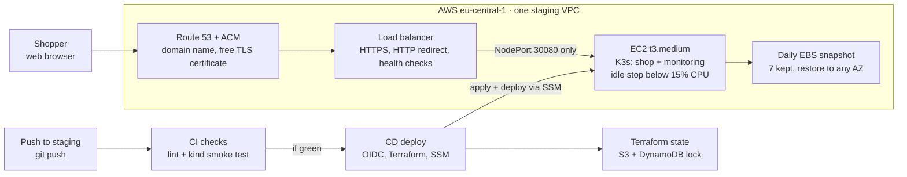

# Sock Shop DevOps: Project Progress Update

_As of 26 Nov 2026 · @Hiu_

## Summary

**Staging is finished and live; production has not started.** Sock Shop, a 14-service demo shop, now goes from `git push` to https://sockshop-staging.link with no manual steps. CI checks every push, and only a fully green run hands over to CD, which builds AWS with Terraform and deploys over SSM.

**What changed since the Nov 23 report (Nov 25):**

- **GitHub OIDC is live.** CD now assumes a short-lived IAM role; no AWS access keys are stored in GitHub. This closes the top security item from the last report.
- **Daily disk backups and one-command restore.** An EBS snapshot runs at 03:00 UTC and 7 are kept (~$2/month). `make restore AZ=b` rebuilds the server from a snapshot in any availability zone in about 15–20 minutes.
- **Idle auto-stop actually works now.** The node idles at 12–13% CPU, so the old 5% threshold never fired and staging ran 24/7. The threshold is now 15%.
- **Login fixed.** Redis (session-db) could not write its snapshots, then refused all writes. It now has a writable `/data` volume.
- **Add to cart fixed (Nov 26).** The cart and orders databases used the untagged `mongo` image, which now pulls MongoDB 8.x. The 2017 carts service's driver can't talk to it (`Unsupported OP_QUERY command`), so every add to cart returned HTTP 500. Both databases are now pinned to `mongo:4.4.0`, matching the Helm chart.
- **Grafana dashboards are provisioned from code**, and stale docs and scripts were cleaned up (Nov 23).

**Still open:** production environment and promotion, `terraform plan` review before apply, alerting (Alertmanager), persistent database storage, secrets (Grafana is still admin/admin) and the K3s 1.27 upgrade. All work is on the `staging` branch; nothing is merged to `master` yet.

## Status at a glance

7 of 13 workstreams are done, 3 are partly done and 3 have not started. Everything in the "Not started" rows belongs to production.

| Workstream | Status | Where it stands (Nov 26) |
| --- | --- | --- |
| CI checks | ✅ Done | Sync check, kubeconform + Helm lint, kind smoke test on every push and PR |
| Infrastructure as Code | ✅ Done | Terraform builds VPC, EC2, ALB, ACM, Route 53, IAM, CloudWatch and DLM; state in S3 + DynamoDB lock |
| CD to staging | ✅ Done | Runs only after green CI; apply, start server, deploy over SSM, end-to-end curl |
| Network lockdown | ✅ Done | Ports 22 and 6443 closed; only NodePort 30080 from the ALB |
| CI credentials (OIDC) | ✅ Done | Short-lived IAM role since Nov 25; no stored AWS keys |
| Backup and restore | ✅ Done | Daily EBS snapshot, 7 kept; `make restore AZ=b` in ~15–20 min |
| Cost control | ✅ Done | t3.medium default; idle stop at <15% CPU for 30 min; `make up / down` |
| Monitoring | 🟡 Partly done | Prometheus + Grafana with dashboards; no Alertmanager, so alerts notify nobody |
| Data persistence | 🟡 Partly done | Disk snapshots exist, but databases use emptyDir and lose data on pod restart |
| Secrets | 🟡 Partly done | Keys gone from GitHub; Grafana still admin/admin, DB credentials in manifests |
| Plan review before apply | ⬜ Not started | CD runs `terraform apply -auto-approve` |
| Production environment | ⬜ Not started | No prod account, Terraform or CD job |
| Merge to master | ⬜ Not started | All work still on `staging` |

## 1. Overview

The goal was to run an open-source microservice shop on AWS so that every push is checked and then deployed to a live HTTPS site with no manual steps. Sock Shop has about 14 services: front-end, catalogue, carts, orders, payment, user, shipping, queue-master, RabbitMQ and their databases.

Work ran from February to November 2026, all on the `staging` branch, in three parts:

- **CI:** GitHub Actions checks every push (manifest validation, Helm lint, and a test deploy in a throwaway kind cluster).
- **Infrastructure as Code:** Terraform builds the whole AWS staging environment (VPC, EC2, K3s, load balancer, HTTPS, DNS, idle auto-stop, daily snapshots) plus a separate admin-applied stack for the GitHub OIDC role.
- **CD:** after a green CI run on `staging`, CD provisions AWS, deploys the shop and monitoring on the server over SSM, and checks the live site end to end.

## 2. How it works

The top row is the pipeline: a push runs CI, and only a green build calls CD, which signs in to AWS through GitHub OIDC and keeps Terraform state in S3. CD builds AWS with Terraform, then runs the deploy on the server over SSM, so kubectl never leaves the server. Shoppers reach the shop through Route 53, the HTTPS load balancer and NodePort 30080; a daily snapshot of the server's disk can rebuild it in any availability zone. Publicly, only ports 80/443 on the ALB are open.

## 3. Why these methods

Each choice traded scale for low cost and simplicity, which suits a single staging environment.

| Choice | What it does here | Why it was chosen | Alternative not used |
| --- | --- | --- | --- |
| Terraform | Builds every AWS resource from code in `staging/` | Repeatable, reviewable, can be destroyed and rebuilt in one command | Clicking in the AWS console |
| S3 backend + DynamoDB lock | Stores Terraform state centrally, one run at a time | CI runners are throwaway; the lock stops two runs clashing | Local state file |
| K3s on one EC2 | Lightweight Kubernetes on a single t3.medium | Real Kubernetes for ~$30/month; EKS charges ~$73/month for the control plane alone | Amazon EKS |
| AWS SSM | CD runs the whole deploy (kubectl) on the server itself | No SSH keys; neither port 22 nor 6443 is reachable from the internet | SSH, or kubectl over 6443 |
| GitHub OIDC | CD gets a short-lived IAM role per run | No long-lived AWS keys to leak or rotate | Access keys in GitHub secrets (used until Nov 25) |
| S3 manifest bundle | CD uploads the manifests for the tested commit; the server fetches them with a 30-minute presigned URL | The server deploys exactly what CI tested, with no Git access or stored credentials | Cloning the repo on the server |
| Elastic IP | Fixed public IP for the server | Address survives stop/start; K3s itself now uses the private IP | Changing public IP |
| ALB + ACM + Route 53 | HTTPS entry point, free certificate, domain name | Managed TLS, HTTP to HTTPS redirect, health checks | Ingress controller with Let's Encrypt |
| NodePort 30080 | Exposes the front-end to the ALB only | No ingress controller to run on a small node | nginx-ingress (removed) |
| DLM snapshots | Daily EBS snapshot, 7 kept | ~$2/month for a full-disk restore point in any AZ | No backup, or Velero |
| Reusable CD workflow | CI calls `cd.yml` only after every check passes | One deploy path; a red build can never reach AWS | Separate CI and CD triggers |
| kind in CI | Spins up Kubernetes inside the GitHub runner | Catches broken manifests for free before AWS is touched | Testing only on AWS |

## 4. CI/CD pipeline

CI blocks broken manifests before anything reaches AWS; only a fully green CI run on `staging` calls CD, which rebuilds staging from code and checks that the live site answers.

**CI** ([.github/workflows/ci.yml](.github/workflows/ci.yml), every push and pull request):

1. **Sync check:** `complete-demo.yaml` must match the individual manifests, so the two never drift.
2. **kubeconform + Helm lint:** validates every Kubernetes YAML and the rendered Helm chart against Kubernetes 1.27.
3. **kind smoke test:** creates a temporary cluster in the runner, deploys the full shop, waits for every deployment, then curls the front-end.
4. **Deploy staging:** only on a push to `staging`, and only after steps 1–3 pass, CI calls `cd.yml` as a reusable workflow.

**CD** ([.github/workflows/cd.yml](.github/workflows/cd.yml), called by CI or started by hand):

1. Check out the exact commit CI tested and get AWS credentials through **GitHub OIDC** (short-lived role, no stored keys).
2. `terraform apply` builds or updates the infrastructure.
3. Start the EC2 instance if the idle alarm stopped it (or wait if it is still stopping), then wait until it is Online in SSM.
4. Upload the shop and monitoring manifests to S3 and create a presigned URL valid for 30 minutes.
5. Over SSM, run `remote-deploy.sh` on the server: pin K3s to the private IP, download the bundle, apply the shop and Prometheus/Grafana, wait for every rollout, and smoke-test front-end, Prometheus and Grafana locally. It fails loudly at any step.
6. End-to-end check: curl https://sockshop-staging.link through Route 53 and the ALB until it answers.
7. Delete the bundle from S3.

CD uses the `staging` GitHub Environment, and a concurrency group stops two deploys running at once. There is no production job yet. When there is one, it will be manual: after the `staging` → `master` pull request is approved, an approved engineer starts the production deploy by hand. A merge never deploys on its own (see section 8).

## 5. AWS and cost

Staging costs about $60–70/month if it runs 24/7, and roughly $30/month when the server is stopped most of the time. Everything runs in eu-central-1 (Frankfurt). Figures are approximate on-demand list prices, not taken from the AWS bill.

| Resource | Size | Approx. USD/month (24/7) | Billed while stopped? |
| --- | --- | --- | --- |
| EC2 K3s server | t3.medium, 4 GB RAM | ~30–35 | No |
| Application Load Balancer | 1 ALB | ~20 | Yes |
| EBS disk | 50 GB gp3 | ~5 | Yes |
| Elastic IP / public IPv4 | 1 address | ~4 | Yes |
| EBS snapshots (new) | 7 daily, incremental | ~2 | Yes |
| Route 53 zone + domain | sockshop-staging.link | ~1 | Yes |
| S3 state + DynamoDB lock | Tiny | <1 | Yes |

**How the downsizing works:**

- A CloudWatch alarm stops the EC2 instance after 30 minutes below **15% CPU**. It was 5% until Nov 25, but the node never drops below ~12% (K3s, Prometheus, JVM services, bot traffic), so the alarm never fired and staging ran 24/7. Over 48 hours of 5-minute samples the minimum was 12.1%.
- `make up`, `make down`, `make status` and `make url` start, stop and check the server by hand. It boots in about 2 minutes.
- CD starts the server itself if the alarm stopped it, so a deploy never fails just because staging was idle.

**Instance sizing history:** t3.micro (1 GB) overloaded and SSM timed out; t3.small (2 GB) still could not start all services; t3.medium (4 GB) works, also with Prometheus and Grafana. On Nov 20 the `variables.tf` default was corrected from t3.large to t3.medium, because the uncommitted `terraform.tfvars` meant CD would have paid for the larger size.

## 6. Risk, cost and security considerations

For a staging demo I put low cost and simplicity first, accepting risks only where losing the environment would cost time, not customer data or money. Since Nov 25 stored AWS keys and "no backup" are off the list; the remaining open items are plan review, alerting, secrets and database persistence.

### Security

| Risk | What I did | Still open |
| --- | --- | --- |
| Server login stolen or brute-forced | No SSH key pair; port 22 closed. All admin access through AWS SSM, logged in AWS | None |
| Kubernetes API (6443) exposed | Port 6443 closed; kubectl runs only on the server, through SSM | None |
| Users bypass HTTPS | ACM certificate on the ALB; HTTP redirects to HTTPS; NodePort 30080 accepts only the ALB security group | None |
| Dashboards exposed | Prometheus and Grafana reachable only through an SSM tunnel | Grafana password is still admin/admin |
| AWS keys leaked | **GitHub OIDC since Nov 25:** CD assumes a short-lived IAM role; no keys stored in GitHub | None |
| App secrets in plain text | Not yet addressed | DB credentials live in the manifests; move to Kubernetes Secrets or Secrets Manager |
| Deploy bundle leaked | Private state bucket; 30-minute presigned URL, masked in logs, file deleted after the run | None major |
| Terraform state leaked or corrupted | S3 encrypted, versioned, public access blocked; DynamoDB lock; state out of Git | None major |
| Server role too powerful | EC2 role has only the AWS-managed SSM policy | None |
| Old, unpinned images | Not yet addressed | Public `weaveworksdemos/*` images from 2016–17; `redis:alpine` untagged (`mongo` pinned to 4.4.0 on Nov 26); K3s 1.27 is end of life |

### Cost

| Decision | Saving | Risk I accepted |
| --- | --- | --- |
| K3s on EC2 instead of EKS | ~$73/month EKS control-plane fee | I manage Kubernetes myself; no managed upgrades |
| One server, no high availability | Pay for one instance, not three | A server failure takes the shop down (now ~15–20 min to restore) |
| Public subnets, no NAT gateway | ~$35/month per NAT gateway | The server has a public IP, so security groups must be strict (they are) |
| Auto-stop after 30 min below 15% CPU | Most of the EC2 cost | The first visitor waits ~2 minutes while it boots |
| ALB instead of a free ingress certificate | None; it costs ~$20/month | Managed TLS and health checks; biggest cost while idle |

### Reliability and operations

| Risk | What I did | Still open |
| --- | --- | --- |
| Broken change reaches AWS | CD runs only after a fully green CI run, including a full kind deploy | CD runs `terraform apply -auto-approve` with no plan review |
| Two deploys clash | One deploy path, a concurrency group and the DynamoDB lock | None |
| Server or AZ lost | **Daily EBS snapshot, 7 kept; `make restore AZ=a\|b\|c`** rebuilds the server in any AZ | Up to 24 hours of data since the last snapshot |
| Database data lost | Accepted for a demo: databases use emptyDir storage | A pod restart wipes orders and users; use persistent volumes |
| Sessions break | session-db now has a writable `/data` volume (Nov 25) | None |
| Silent failures | Smoke tests on the server, end-to-end check of the live URL, Prometheus alert rules | No Alertmanager, so alerts notify nobody; logs only on the node |

## 7. Challenges and what failed

The hardest problem was how K3s used the Elastic IP: about four certificate fixes in May, then the root cause of a broken cluster in November. Most other failures were small mismatches between files (ports, paths, variables, thresholds) that only showed up at deploy time or in production-like use.

| Date (2026) | Problem | Cause | Fix |
| --- | --- | --- | --- |
| Nov 26 | Add to cart returned HTTP 500 | Untagged `mongo` pulled MongoDB 8.x, which removed the legacy wire opcodes the old carts driver uses | Pinned carts-db and orders-db to `mongo:4.4.0` |
| Nov 25 | Login broke; Redis returned MISCONF | session-db had a read-only root filesystem and no `/data` volume, so snapshots failed and Redis refused all writes | Mounted an emptyDir at `/data` |
| Nov 25 | Staging never auto-stopped | Idle threshold 5% CPU, but the node never drops below ~12% | Threshold raised to 15% |
| Nov 25 | Deploy failed while the server was shutting down | CD tried to start an instance that was still `stopping` | CD now waits for a stopping instance first |
| Nov 20 | CoreDNS never ready; user and catalogue restarted thousands of times; metrics pods crash-looped | K3s was started with an old Elastic IP as its external IP, so pods called an API address that no longer existed | K3s uses the private IP; the deploy script fixes old configs and fails if the API endpoint is wrong |
| Nov 20 | Public ports, duplicate deploys, oversized default | Security group open to 0.0.0.0/0; `ci.yml`, `cd.yml` and `main.yaml` all deployed; t3.large default | Only 30080 from the ALB; CI calls CD only when green; deleted `main.yaml`; default t3.medium |
| Jul 29 | Cost too high for an idle demo | Server ran 24/7 | Auto-stop alarm plus `make up/down` |
| May 20 | ALB health checks failed (502) | Front-end NodePort was 30001, ALB expected 30080 | NodePort 30080 in both manifests |
| May 20 | CI kind setup broke | Third-party `engineerd/setup-kind` action stopped working | Install kind directly with curl |
| May 9–20 | kubectl rejected the server certificate | Cert made for the old IP; IP changed on restart | Elastic IP, `--tls-san`, CD cert patch; replaced on Nov 20 by kubectl on the server |
| May 10 | Cert-fix script broke when sent through SSM | Quotes and newlines mangled in the JSON command | Script written to a temp file, passed with `jq --rawfile` |
| May 9 | Terraform state locked; CI lost state | State was local; a cancelled run left a lock | State moved to S3 with a DynamoDB lock |
| May 1 | CD stopped at a prompt | `bastion_cidr_block` had no default | Added a default |
| Apr 22 | Pods would not start; SSM timed out | t3.micro and t3.small had too little memory | Moved to t3.medium |
| Apr 22 | Deploy failed on a missing dependency | Old nginx-ingress chart no longer downloadable | Removed nginx-ingress; ALB + NodePort |
| Apr | AWS CLI "Signature expired" | Laptop clock was wrong | Re-synced the clock |
| Mar | kubeconform failed on non-Kubernetes files | It scanned Helm templates and Terraform folders | Excluded those paths |

## 8. Next steps and production plan

The top priority is now production; GitHub OIDC and backups from the Nov 23 list are done. Cheap staging hardening comes first because it de-risks production.
### Staging hardening (≈ $0–5/month extra)

| Priority | Area | Improvement | Why |
| --- | --- | --- | --- |
| High | Monitoring | Deploy Alertmanager to Slack or e-mail (`manifests-alerting/` exists) | Alert rules exist but notify nobody |
| High | Security | Change the Grafana password; move DB credentials to Secrets | admin/admin and plain-text credentials |
| Medium | CI/CD | `terraform plan` on pull requests; apply only after approval | See changes before they hit AWS |
| Medium | Reliability | PersistentVolumes (K3s local-path) for the databases | A pod restart loses all orders and users |
| Medium | Supply chain | Pin every image tag; mirror to ECR with scan-on-push | Images are from 2016–17; `redis:alpine` is untagged; an untagged `mongo` already broke the cart once |
| Medium | Platform | Upgrade K3s from 1.27 to a supported version | 1.27 is end of life |
| Low | Cost | AWS Budget + Cost Anomaly Detection (free) | Catch surprises early |
| Low | Sizing | Run the load test in `manifests-loadtest/` | Size production on data, not guesses |

### Production plan (recommended: EKS, multi-AZ, ~4–5 engineer-weeks)

Decisions needed first: target availability (e.g. 99.9%), expected traffic, whether shop data must persist, monthly budget, and the production domain.

1. **Foundation (2–3 days):** separate prod AWS account, own state bucket and OIDC role, `production` GitHub Environment that only approved people can deploy to, by hand; CloudTrail, GuardDuty, Budgets.
2. **Terraform refactor (2–3 days):** move `staging/` into reusable modules with `envs/staging` and `envs/prod`.
3. **Network (1–2 days):** VPC across 3 AZs; ALB and NAT public, nodes private; S3 gateway endpoint.
4. **Cluster (3–4 days):** EKS with 3 × t3.large (one per AZ), EBS CSI, AWS Load Balancer Controller, autoscaling.
5. **Data (2–3 days):** databases as StatefulSets on gp3 volumes; AWS Backup daily, weekly cross-region copy.
6. **App hardening (3–4 days):** Helm chart with prod values, ≥2 replicas, PDBs, limits, HPA, NetworkPolicies, pinned images from ECR.
7. **Security (2 days):** WAF on the ALB, Secrets Manager via External Secrets, Pod Identity, no public node IPs.
8. **Observability (2–3 days):** kube-prometheus-stack with Alertmanager, ALB 5xx alarms, Fluent Bit to CloudWatch Logs.
9. **CI/CD promotion (2 days):** `staging` → PR to `master` → reviewer approves → an approved engineer starts the prod deploy **by hand** (Run workflow). A merge never deploys on its own. `helm upgrade --atomic`, smoke test and automatic rollback; the same image digest is promoted.
10. **Go-live (2–3 days):** load test at 2× peak, restore drill, runbooks, DNS cut-over.

| Option | Setup | USD/month on-demand | With 1-yr Savings Plan | Availability |
| --- | --- | --- | --- | --- |
| A. Lean | Hardened single K3s node, t3.xlarge | ≈ 215 | ≈ 175 | One AZ; ~20 min downtime during a restore |
| **B. Recommended** | **EKS, 3 × t3.large across 3 AZs** | **≈ 440** | **≈ 375** | **Survives losing a node or an AZ** |
| C. Fully managed data | B + DocumentDB, RDS, ElastiCache, Amazon MQ | ≈ 750–850 | ≈ 690–790 | B + managed DB failover and point-in-time recovery |

Option B is the smallest setup that survives losing an AZ and runs the same way as staging. Move individual databases to managed services only when durability becomes a business requirement. Internet data transfer ($0.09/GB after 100 GB) is not included.

## 9. What I learned

The biggest lesson: most failures came from small mismatches between files and assumptions, not from the tools themselves.

- **Infrastructure as Code:** with Terraform I can destroy and rebuild the whole environment. Remote state, a fixed IP and backups belong in place on day one, not after things break.
- **Kubernetes in practice:** I learned to size memory for 14 services, to expose apps with NodePort or ingress, and how TLS certificate SANs work. Running kubectl on the server over SSM was simpler and safer than keeping the API reachable and patching its certificate.
- **Networking:** a workaround can become the next bug. Pinning K3s to the Elastic IP fixed kubectl in May, then broke DNS inside the cluster once that IP was stale.
- **CI/CD design:** a free kind cluster catches most errors before AWS costs money. There should be one deploy path, gated on green CI, and steps should fail loudly.
- **Credentials:** OIDC was less work than expected and removes a whole class of risk; it should have been the starting point.
- **Cloud cost:** a cost control is only real once you see it fire. The 5% idle alarm looked right but never triggered; measuring the real idle CPU (12%) fixed it. Fixed costs such as the ALB keep billing while the server is off.
- **Defaults matter:** an uncommitted tfvars file meant CI would have paid for a bigger server, and a read-only filesystem silently broke Redis writes.
- **Debugging:** reading logs over SSM and keeping one source of truth for ports and names solved most problems.
